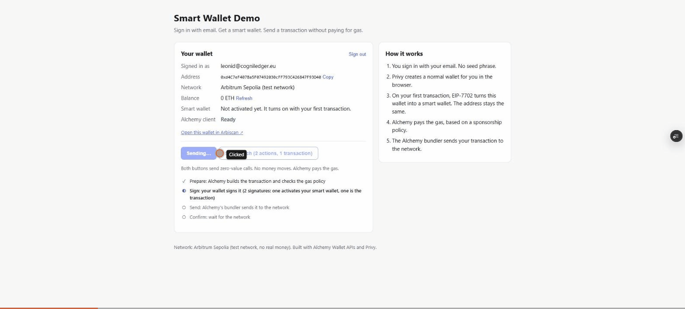

# Smart Wallet Demo: Alchemy Wallet APIs + Privy

Email login → smart wallet (EIP-7702) → a transaction with gas paid by the app → two actions in one transaction. Built on Alchemy Wallet APIs (v5) and Privy, on Arbitrum Sepolia.

**Live demo:** https://alchemy-smart-wallet-demo.vercel.app



## Why this use case

I chose the newest and least tested path in Alchemy's wallet product, on purpose.

- **The SDK is new.** `@alchemy/wallet-apis` v5 became stable in May 2026. I used 5.3.0, released three days before I started. Most examples on the internet are for the old SDK.
- **The login part changed.** Alchemy's own Account Kit is now deprecated. The docs recommend Privy for login and keys, and Alchemy for transactions and gas. This pairing is new, and new pairings break in new ways. My strongest finding ([entry 6](./FRICTION_LOG.md#6-install-works-on-my-machine-then-fails-on-vercel)) exists only because of it.
- **EIP-7702 is the default.** Since Ethereum's Pectra upgrade (May 2025), a normal wallet can become a smart wallet on the same address. No second address, no moving funds. This is where wallets are going, and Alchemy made it the default.
- **Gas sponsorship is the core value.** For the user, it removes the first barrier: a new user has no crypto to pay fees. For Alchemy, it is a paid product, so questions about it reach support first.

A new path is where customers get stuck today. So it is where a friction log is most useful.

## Why this exists

I am a product owner, not a developer by background. I wanted to walk the path of a developer who builds on Alchemy Wallet APIs myself, from an empty folder to a working sponsored transaction, and write down every place where that path is hard.

The site is the proof that it works. The two documents are the main result:

- **[FRICTION_LOG.md](./FRICTION_LOG.md)**: 14 real problems, each written down when it happened, with time lost and a suggestion. Ends with the **Top 3 improvements** I would ship first.
- **[TROUBLESHOOTING.md](./TROUBLESHOOTING.md)**: a runbook for a support team. Symptom, cause, check, fix, and a docs link for each problem.

## How it works

```
  You                Privy               Alchemy Wallet APIs          Arbitrum Sepolia
   │  email + code     │                        │                            │
   ├──────────────────►│ creates a normal       │                            │
   │                   │ wallet (EOA)           │                            │
   │  press "Send"     │                        │                            │
   ├───────────────────┼───────────────────────►│ 1. prepare: build the      │
   │                   │                        │    operation, attach the   │
   │                   │                        │    gas policy              │
   │                   │◄───────────────────────┤ 2. ask for signatures      │
   │                   │ signs (first time also │                            │
   │                   │ signs the EIP-7702     │                            │
   │                   │ authorization)         │                            │
   │                   ├───────────────────────►│ 3. send: check the policy, │
   │                   │                        │    bundler pays the gas    ├──► included
   │◄──────────────────┴────────────────────────┤ 4. confirm: receipt        │
   │  "Done. You paid $0 in gas."               │                            │
```

1. You sign in with your email. No seed phrase.
2. Privy creates a normal wallet for you in the browser.
3. On your first transaction, EIP-7702 turns this wallet into a smart wallet (Modular Account v2). The address stays the same.
4. Alchemy pays the gas, based on a sponsorship policy (Gas Sponsorship / BSO).
5. The Alchemy bundler sends your transaction to the network.

Example transactions:
- First transaction (activation + call): [0xcaf3…5092](https://sepolia.arbiscan.io/tx/0xcaf326a2ddd782695a6b79cc69176fcd4335236237a2a6a6c206798d0bc95092)
- Batch, 2 calls in 1 transaction: [0x41a1…3cf1](https://sepolia.arbiscan.io/tx/0x41a179ec94ee33584a9c83869787a8dbe46c94b4e868d2ab1b610bfaf69e3cf1)

The user's balance is 0 ETH before and after. That is the point.

## Run it locally

You need Node.js 20+ and three values from two dashboards.

**1. Alchemy** ([dashboard.alchemy.com](https://dashboard.alchemy.com)):
1. Create an app. Enable the **Arbitrum Sepolia** network. Select **Node API**, **Bundler API** and **Gas Manager**.
2. Copy the **API key**.
3. Gas Sponsorship → Create policy → same app → type **Gas Sponsorship** → Arbitrum Sepolia. Set low limits. Make sure it is **Active**. Copy the **Policy ID**.
4. Optional: Security → Allowlist → Domain → add `localhost` and your domain.

**2. Privy** ([dashboard.privy.io](https://dashboard.privy.io)):
1. Create an app. Make sure **Email** login is on.
2. App settings → Basics → **Domains and clients** → Allowed origins → add `http://localhost:3000`.
3. Copy the **App ID**.

**3. Install and start:**
```bash
git clone https://github.com/CryptoDetails/alchemy-smart-wallet-demo.git
cd alchemy-smart-wallet-demo
cp .env.example .env.local   # then paste the three values
npm ci
npm run dev                  # open http://localhost:3000
```

Note: the repo has `.npmrc` with `legacy-peer-deps=true` and pins `viem` to `2.56.5`. Without them the install fails. See [TROUBLESHOOTING A1–A3](./TROUBLESHOOTING.md#a1-eresolve-about-solanakit-on-a-clean-install).

**Deploy to Vercel:** import the repo, add the same three variables in Settings → Environment Variables, then **Redeploy**. Add the Vercel domain to the Privy allowed origins and the Alchemy domain allowlist.

## Where things are

| File | What it does |
|---|---|
| `app/providers.tsx` | Privy setup: email login only, embedded wallet for every user, no wallet pop-ups |
| `lib/useSmartWallet.ts` | Privy wallet → viem signer → `createSmartWalletClient` with the gas policy; reads balance and status |
| `lib/sendFlow.ts` | The four steps (prepare, sign, send, confirm), split from `sendCalls` so the user can see them |
| `lib/chain.ts` | Network, explorer, and how to read the EIP-7702 status from the account code |
| `lib/errors.ts` | Raw errors → clear messages. Each type is in TROUBLESHOOTING section E |
| `components/` | The wallet card, the send buttons, the step list and the error box |

## Limits

- Test network only. No real money. No smart contracts of my own.
- The API key is public by design (browser app). It is protected by a domain allowlist and low policy limits. See [TROUBLESHOOTING B5](./TROUBLESHOOTING.md#b5-the-api-key-is-visible-in-the-browser).
- The policy allows 10 sponsored transactions per wallet. After that the demo shows a clear limit message.

---

Built by Leonid Khatskevych with Claude Code.
